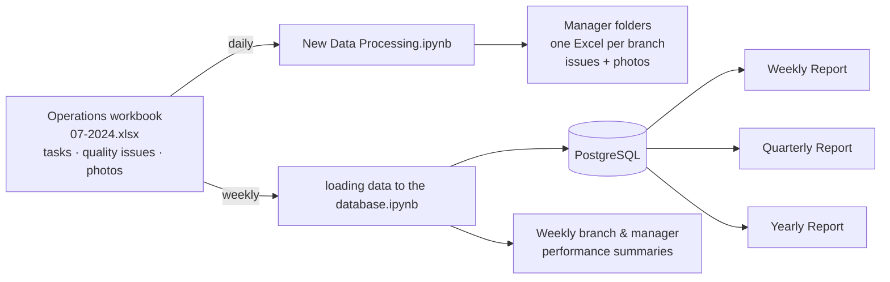

# AOF Group — Operations Data Pipeline

A data pipeline and reporting system I built at **AOF Group** for its restaurant brands **Shawarma Classic** and **Lubda** (Saudi Arabia). It turns the operations team's quality-control workbook into a daily action list for each area manager, a PostgreSQL history updated every week, and a set of weekly, quarterly and yearly Power BI reports.

**Role:** Data Analytics Engineer · February 2024 – present

## Impact

| **−85%** quality issues | **+15.8%** submission rate | **8 → 4 h/day** reporting time | **12** stakeholders |
|---|---|---|---|
| across the company | on scheduled tasks | daily reporting effort cut in half | 10 area managers, Development Manager, Operations Manager |

> **Note on data:** the company's real data, staff names, internal IDs and credentials are not in this repository. Everything in `sample_data/` is generated and fictional.

## At a glance

| | |
|---|---|
| **Scope** | ~37 branches across Riyadh, Jeddah and the Eastern Province, 10 area managers, two brands, ~25 menu items with their own SOP checklists |
| **Source** | Operations workbook (`07-2024.xlsx`) with daily task and quality-issue logs, including field photos; `Lubda.xlsx` for the Lubda brand |
| **Processing** | Python / Jupyter: pandas, openpyxl, psycopg2 |
| **Storage** | PostgreSQL: `shawarma_classic` (schema `training`) and `lubda` (schema `operation`) |
| **Reporting** | Power BI weekly, quarterly and yearly reports in a custom brand theme; formatted Excel files for each manager |
| **Period** | February 2024 onward |

## Current architecture



| Cadence | Step | Output |
|---|---|---|
| **Daily** | `New Data Processing.ipynb` reads yesterday's quality issues from the workbook and splits them by area manager and branch | A folder per manager, with one formatted Excel file per branch. Each file lists that branch's issues with the photos embedded |
| **Weekly** | `loading data to the database.ipynb` pushes the new tasks and issues into PostgreSQL and computes the weekly rankings | Updated database; branch and manager performance summaries |
| **Weekly** | Power BI refresh | Weekly Report |
| **Quarterly** | Power BI refresh | Quarterly report (e.g. *Q2 Analysis*) |
| **Yearly** | Power BI refresh | Yearly Report, per brand |

More detail in [docs/architecture.md](docs/architecture.md).

## Try it

The repo includes the two production notebooks, cleaned up to run on **fake sample data** with the same structure as the real workbook: 36 branches, 10 managers, two weeks of tasks and issues, and in-cell photos.

```bash
pip install -r requirements.txt
```

**Daily distribution.** No database needed. Run [notebooks/01_daily_issue_distribution.ipynb](notebooks/01_daily_issue_distribution.ipynb). It writes `output/managers/<Manager>/<Branch>.xlsx`, one file per branch with the issue photos embedded.

**Weekly load and rankings.** Start a local Postgres, which creates the tables from [sql/schema.sql](sql/schema.sql) and the ranking functions from [sql/ranking.sql](sql/ranking.sql):

```bash
docker compose up -d
```

Then set the variables from [.env.example](.env.example) and run [notebooks/02_weekly_load_and_rankings.ipynb](notebooks/02_weekly_load_and_rankings.ipynb). It loads the new rows, writes the branch and manager rankings to `output/`, and reads the same rankings back from the SQL functions in [sql/ranking.sql](sql/ranking.sql). If you don't have Docker, set `LOAD_TO_DB=0` to skip the database and still get the rankings.

| Folder | Contents |
|---|---|
| [notebooks/](notebooks) | The daily and weekly notebooks |
| [sample_data/](sample_data) | Fake workbook and managers file, plus [the script that generates them](sample_data/generate_sample_data.py) |
| [sql/](sql) | Table definitions, the [weekly ranking in SQL](sql/ranking.sql) (functions and views), and the production schema exports in `sql/production/` |

## Documentation

| Doc | Contents |
|---|---|
| [docs/architecture.md](docs/architecture.md) | The flow step by step, data model, design decisions, how the system evolved |
| [docs/database.md](docs/database.md) | PostgreSQL databases, tables, diagram, example queries |
| [docs/pipeline.md](docs/pipeline.md) | Each notebook and script: what it does, inputs, outputs |
| [docs/metrics.md](docs/metrics.md) | Done rate, performance score, ranking and grading logic |
| [docs/reports.md](docs/reports.md) | The Power BI and Excel deliverables |
| [docs/case-study.md](docs/case-study.md) | Portfolio write-up: problem, approach, outcome |

## Tech stack

`Python` · `pandas` · `openpyxl` · `PostgreSQL` · `psycopg2` · `Jupyter` · `Power BI`

## Author

**Ahmed Khaled** · [GitHub](https://github.com/alaalmy-ahmed)
