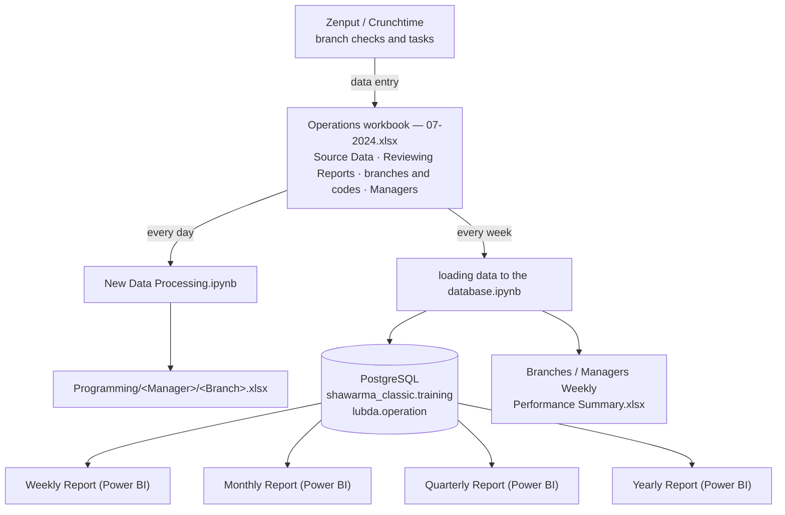

# Architecture

## The flow

### 1. Source: the operations workbook

Branch checks and scheduled tasks are recorded in Zenput (now Crunchtime OPS Execution). A data-entry employee copies the results into `07-2024.xlsx` every day. I designed this workbook to replace the earlier process of screenshots pasted into Word files. Data validation on every column, lookups for branch codes and managers, and a fixed list of issue descriptions keep the entries consistent.

| Sheet | Contents |
|---|---|
| Source Data | Scheduled tasks per day: meal, team, due time, done / missed counts, and which branches missed delivery |
| Reviewing Reports | Quality issues: date, branch, meal, description, manager, with a photo in the `Images` column |
| branches and codes | Branch ↔ branch code |
| Managers | Branch ↔ area manager |
| Fixed Choices | Allowed values, so entries stay consistent |

The Lubda brand has its own workbook (`Lubda.xlsx`, sheets `Tasks` and `Issues`, with Arabic headers).

### 2. Daily: distributing quality issues

`New Data Processing.ipynb` runs every morning:

1. Reads *Reviewing Reports* and keeps **yesterday's** issues.
2. Looks up each branch's area manager.
3. Creates a folder per manager under `Programming/`. There are 10 area managers, each with their own branches.
4. Writes one formatted Excel file per branch with that day's issues, page-ready: Calibri, centred, wrapped, bordered.
5. **Embeds the field photos.** Excel stores in-cell pictures as rich values, and pandas and openpyxl drop them when reading. The notebook opens the `.xlsx` as a zip and maps each picture back to its row through `rdrichvalue`/`richValueRel` and the cells' `vm` attribute. Then it re-embeds a resized copy (200 px) in the right row of the manager's file.

Each manager opens their folder and sees only their branches, the issues and the evidence.

### 3. Weekly: loading the database

`loading data to the database.ipynb` runs once a week:

1. Reads *Source Data* and *Reviewing Reports*.
2. Reshapes tasks: collapses team-level rows to `Date × Meal`, then **explodes** the "Branches Missed Tasks" text into one row per branch.
3. Reads `MAX(date)` from each table and inserts **only newer rows**, so running it twice does no harm.
4. Does the same for Lubda into the `lubda` database.
5. Computes the weekly branch and manager rankings ([metrics.md](metrics.md)) and exports them to Excel.

### 4. Reporting

Power BI connects to PostgreSQL. After each load, the **Weekly Report** is refreshed: it compares each branch's last 7 days with the 7 days before. The **Monthly** (manager performance), **Quarterly** (branch performance) and **Yearly** (for the CEO) reports read from the same tables, so they need no separate data preparation, just a refresh at the end of the period. See [reports.md](reports.md).

## Data model

**`shawarma_classic.training`**

| Table | Columns |
|---|---|
| `issues` | date, branch, meal, description, manager |
| `tasks` | date, meal, done_tasks, missed_tasks, branch_missed, due_time |

**`lubda.operation`**

| Table | Columns |
|---|---|
| `issues` | date, project, branch, problem, manager, notes |
| `tasks` | date, project, done_tasks, branch_missed |

`tasks` holds one row per branch that missed a task (`branch_missed` is empty when nothing was missed), so missed-task counts per branch come from a plain `GROUP BY`. There is also a `training.branches` reference table (code ↔ name).

Column types, a diagram and example queries are in [database.md](database.md).

## Design decisions

- **Validate at entry.** Data validation and lookups in the workbook stop most errors before they reach the pipeline.
- **Excel first, database when needed.** The workbook was the quickest way to turn screenshots into data. When the history outgrew it, the data moved to PostgreSQL while the workbook stayed as the entry form.
- **Manager stored on each issue.** Upper management reassigns branches between managers every month, so each issue keeps the manager responsible on that day.
- **Daily and weekly cadences are separate.** Managers need issues the next morning; the database and reports only need to be current once a week. Separating the two keeps the daily step fast and lets the weekly load run unattended.
- **Incremental, idempotent loads** keyed on the latest date already in the database.
- **One database, many reports.** Weekly, quarterly and yearly reports all read the same tables, so the numbers always agree.

## How it evolved

| Stage | Approach |
|---|---|
| Before Feb 2024 | Screenshots from Zenput pasted into Word, then one Word file per manager, made by hand |
| Early 2024 | Structured workbook with validation and lookups; first scripts that split the daily sheet per manager (`seperating.ipynb`, `Data Processing.ipynb`) |
| Late 2024 | Experiment with Google Forms → Sheets → PostgreSQL, with a backup database and a Flask push endpoint (`distributing_branches.py`, `web server database.py`) |
| Mid 2025 | Lubda launches: its own workbook, database and reports, built from the start |
| Current | Workbook → daily distribution with photos → weekly incremental load → weekly, monthly, quarterly and yearly Power BI reports |

## Next steps

- Schedule the daily and weekly notebooks (Task Scheduler, cron or Airflow).
- Move database credentials out of the notebooks into environment variables.
- Convert the notebooks into scripts or dbt models with tests.
