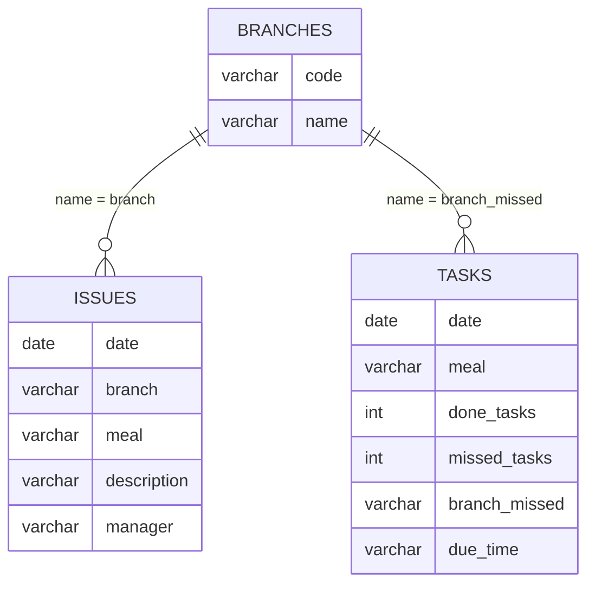

# Database

PostgreSQL 16.3. One database per brand, so each brand's data, loads and reports stay independent.

| Database | Schema | Tables | Loaded by |
|---|---|---|---|
| `shawarma_classic` | `training` | `issues`, `tasks`, `branches` | Weekly load notebook, Shawarma Classic section |
| `lubda` | `operation` | `issues`, `tasks` | Weekly load notebook, Lubda section |

The full schema exports (structure only, no data) are in [`sql/production/`](../sql/production). The `shawarma_classic` database also contains an `operation` schema laid out like the Lubda tables.

## Tables



*Shawarma Classic (`training` schema). The joins are by branch name; the database doesn't enforce them as foreign keys.*

### `training.issues`: one row per quality issue

| Column | Type | Notes |
|---|---|---|
| date | date | Day the issue was found |
| branch | varchar(255) | Bilingual branch name, e.g. `Al Olaya - العليا` |
| meal | varchar(50) | Menu item / SOP |
| description | varchar(50) | Picked from a fixed list in the workbook, so values stay consistent |
| manager | varchar(50) | Area manager responsible at the time |

### `training.tasks`: one row per branch that missed a scheduled task

| Column | Type | Notes |
|---|---|---|
| date | date | |
| meal | varchar(50) | |
| done_tasks, missed_tasks | integer | Totals for that meal and slot, across all branches |
| branch_missed | varchar(255) | The branch that missed it, or `''` when no branch missed |
| due_time | varchar(50) | Time slot, e.g. `8-12 pm` |

The workbook stores missed branches as one newline-separated text cell. The load notebook splits that cell so each branch gets its own row. That way, "how many times did branch X miss a task this quarter" is a plain `GROUP BY` instead of string parsing inside Power BI.

### `training.branches`

Branch code ↔ name reference table.

### `training.branch_managers`

Branch → area manager. It's added by [`sql/ranking.sql`](../sql/ranking.sql) and isn't in the production export yet. The weekly notebook fully refreshes it and `branches` from the workbook on each run.

## Ranking functions and views

*Portfolio addition, not used in production.* [`sql/ranking.sql`](../sql/ranking.sql) computes the weekly branch and manager rankings inside Postgres:

| Object | Returns |
|---|---|
| `training.branch_weekly_ranking(report_date)` | Manager, branch, done rate, issues, rank, grade |
| `training.manager_weekly_ranking(report_date)` | Manager, done rate, issues per branch, issues, rank |
| `training.v_branch_weekly_ranking` | Branch ranking for the week ending yesterday |
| `training.v_manager_weekly_ranking` | Manager ranking for the week ending yesterday |

These were written for this portfolio and aren't in production; at AOF the ranking is computed in pandas. Power BI could import the views directly instead of the weekly Excel summaries. The method and how it was checked against the pandas version are in [metrics.md](metrics.md#two-implementations).

### `lubda.operation`

| Table | Columns |
|---|---|
| `issues` | date, project, branch, problem, manager, notes |
| `tasks` | date, project, done_tasks, branch_missed |

## Example queries

Missed tasks per branch for a quarter:

```sql
SELECT branch_missed AS branch, COUNT(*) AS missed
FROM training.tasks
WHERE branch_missed <> ''
  AND date >= DATE '2025-04-01' AND date < DATE '2025-07-01'
GROUP BY branch_missed
ORDER BY missed DESC;
```

Issues per month and meal:

```sql
SELECT date_trunc('month', date)::date AS month, meal, COUNT(*) AS issues
FROM training.issues
GROUP BY 1, 2
ORDER BY 1, 3 DESC;
```

## Design choices

- **Database per brand.** Lubda's columns are in Arabic and its process differs slightly. Separate databases let each evolve without breaking the other's reports.
- **Append-only, date-based loads.** The weekly load reads `MAX(date)` and inserts only newer rows, so the tables are a growing history that Power BI can slice by week, quarter or year.
- **Manager stored on each issue.** Branches change hands. Keeping the manager on the row means past reports still credit the manager who was responsible at the time.

## What I'd add next

- A primary key on each table and a unique constraint on `(date, meal, branch_missed)`, so a duplicate load is rejected by the database itself, not only by the notebook's date check.
- Indexes on `date` (and `branch`) for the quarterly and yearly reports as history grows.
- Foreign keys from `issues.branch` and `tasks.branch_missed` to `branches`.
- Point the Power BI weekly report at the ranking views.
